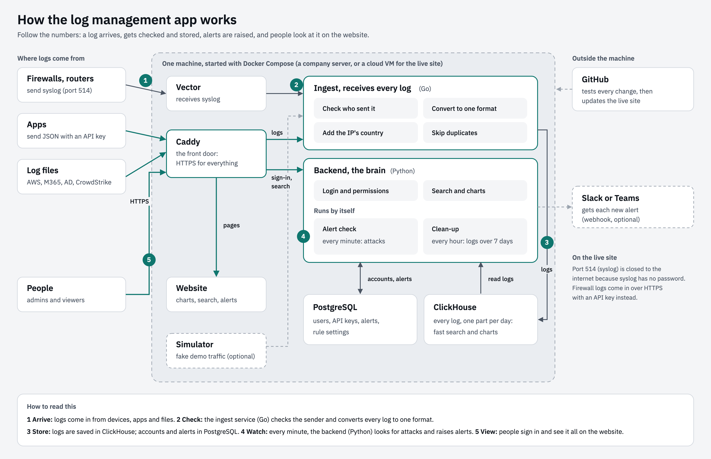
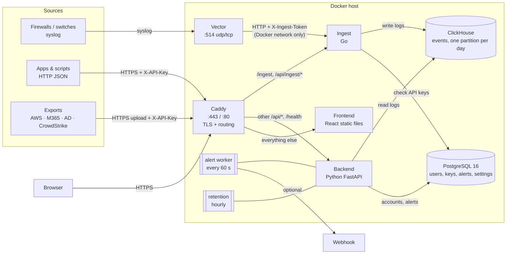

# Architecture

A small multi-tenant log management (SIEM-lite) system. It ingests logs from seven kinds of
sources, normalizes them into one schema (a Go service), stores them in ClickHouse, and offers search, a
dashboard and alerts. PostgreSQL holds users, API keys, alerts and settings. Everything runs from
one `docker-compose.yml`, either on a single VM (**appliance**) or on a public cloud VM with a real
HTTPS domain (**SaaS**).

## Components



The same picture as a text diagram (renders on GitHub):



| Component | Job | Why this choice |
|-----------|-----|-----------------|
| **Caddy** | The only public entry point. Terminates TLS and routes `/ingest` and `/api/ingest/*` to the ingest service, other `/api/*` and `/health` to the backend, everything else to the frontend. Blocks `/api/ingest/syslog` from outside. | Automatic HTTPS: Let's Encrypt in SaaS mode, its own local CA in appliance mode, from one Caddyfile. |
| **Vector** | Listens for syslog on 514 and forwards raw lines plus the sender IP to the ingest service in batches; retries if it's down. | Handles the network side (UDP/TCP, batching, retries) so the ingest service only gets HTTP. Parsing stays in Go, where it is unit-tested. |
| **Ingest** (Go) | Receives every log (JSON, file uploads, syslog), checks the API key, normalizes it, adds the country, skips duplicates and stores it in ClickHouse. | The one part that handles every log, so it's written in Go: many requests per CPU core, little memory, one ~30 MB binary. See **Why two languages**. |
| **Backend** (Python) | FastAPI app: login, search, stats, alerts, API keys and rules. Two background tasks: the alert worker and retention. | Async Python, Pydantic validation, interactive API docs at `https://<host>/docs` for free. Background tasks run in-process: no extra queue or container for two periodic jobs. |
| **ClickHouse** | The events (logs): ingest, search, dashboard, alert detection, retention. | A column store: reads only the columns a query needs, compresses repeated values, and drops a whole day at once. See **Storage**. |
| **PostgreSQL 16** | Users, API keys, alerts, rule settings, sign-in failures. | Small data that is edited often and needs unique constraints and transactions. |
| **Frontend** | React + Vite + TypeScript SPA (dashboard, search, alerts), built to static files. | Served by a tiny internal Caddy; no Node at runtime. |

All images are multi-arch (linux/amd64 and linux/arm64).

## Data flow of one event

Steps 1–6 happen in the Go ingest service (`ingest/`), 7–8 in the Python backend.

1. **Arrives**:
   - syslog: device → Vector → `POST /api/ingest/syslog` (internal token);
   - JSON: client → `POST /api/ingest?source=...` (API key);
   - file: client → `POST /api/ingest/file` (API key).
2. **Tenant is decided**: from the API key, or for syslog from the sender IP (`SYSLOG_TENANT_MAP`,
   otherwise `DEFAULT_TENANT`). A `tenant` field in the body is never trusted: if it names a
   different tenant than the key's, that event is rejected (so a mislabelled sample can't land in the
   wrong tenant).
3. **Normalized**: `ingest/normalize/<source>.go` maps the payload to the common schema
   (`Event`, whose `Validate()` rejects impossible values). The original payload is kept in `raw`.
4. **Checked**: events older than `RETENTION_DAYS` (or more than a day ahead) are stored at the
   time they arrive and tagged `time_adjusted`; the original time stays in `raw`. Events that can't
   be read are rejected with a reason, and never block the good ones in the same batch.
5. **Enriched**: the country of `src_ip` is looked up in the DB-IP Lite database
   (`ingest/geoip`, downloaded when the image is built, read locally) and stored as `src_country`.
   Private and reserved addresses have no country.
6. **Stored** in ClickHouse. The service computes a `fingerprint` (sha256 of tenant + source + raw)
   and skips events whose fingerprint and time are already stored, so duplicates are counted, not
   stored. If ClickHouse is down, ingest answers 503 and the sender retries.
7. **Detected**: the alert worker picks up matching events that arrived in the last 10 minutes and
   checks their event-time history against each rule (e.g. 5+ failed logins from one IP in any 5 minutes).
8. **Expired**: the retention job drops whole days older than `RETENTION_DAYS`.

## Why two languages

| Part | Language | Why |
|---|---|---|
| Ingest (every log passes through it) | **Go** | It's the busy path: its speed decides how many logs one server can take. Go serves many requests per CPU core with little memory, and ships as one small binary. |
| Backend (login, search, dashboard, alerts) | **Python** | Few requests, mostly business rules. Python + FastAPI is quick to write and test, and its interactive API docs come for free. |

The heavy lifting elsewhere is already in compiled tools: Vector (Rust) receives syslog, Caddy
(Go) terminates TLS, and ClickHouse (C++) stores and summarizes the logs. Real log platforms
split work the same way: a fast language on the path every log takes, and whatever the team
builds fastest in for the rest. If ingest traffic grows further, the next steps are more copies
of the ingest service behind Caddy, then a queue (e.g. Kafka) in front of it.

## Storage

Each database does what it's good at:

| Data | Store | Why this one |
|---|---|---|
| Events (logs): huge, written once, never edited, summarized constantly | **ClickHouse** | Column storage reads only the columns a summary needs, compresses repeated values 5–10×, and drops old days at once |
| Users, API keys, alerts, rule settings, sign-in failures: small, edited often | **PostgreSQL** | Fast single-row updates (acknowledge, revoke, change a password), unique constraints and transactions |

**Why not Postgres alone?** At billions of rows, summaries (counts, top lists, timelines) get slow
because Postgres reads whole rows, and storage is costly without columnar compression.
**Why not ClickHouse alone?** It's built for appends and big scans: single-row edits are slow,
asynchronous "mutations", and it has no unique constraints or transactions, which logins and keys need.

```
ClickHouse                                    PostgreSQL
events (PARTITION BY toDate(ts),              users       api_keys        alerts
        ORDER BY (tenant, ts, fingerprint))   role        key_hash        rule_id, group_key
 ├─ 20261008  one partition per UTC day       tenant      tenant          window_start/end
 ├─ …                                         bcrypt      revoked_at      event_count, status
 └─ 20261014  (created by the first insert)                               webhook_sent_at
events_minutely  per-minute totals, kept up
                 to date by a materialized view
```

- **Sorted by tenant and time.** `ORDER BY (tenant, ts, …)` stores each tenant's events together in
  time order, so a search or summary reads only that tenant's slice of the days asked for.
- **Day partitions.** Retention is `ALTER TABLE … DROP PARTITION`: instant, with no slow `DELETE`.
  A `TTL` removes the same rows as a safety net when ClickHouse merges.
- **Ready-made totals.** A materialized view adds every insert to `events_minutely`, so dashboard
  counts and timelines cost the same at a thousand events or a billion.
- **Skip indexes** (bloom filters on IP, user, host and id; a token index on the raw log) let
  ClickHouse skip blocks that can't match a filter.
- **Duplicates.** ClickHouse has no unique constraint, so the app checks (fingerprint, ts) before
  inserting; `ReplacingMergeTree` on the same key removes anything that slips through.
- **Migrations**: Postgres uses numbered SQL files applied at startup by a short runner
  (`app/migrate.py`), each in a transaction, guarded by an advisory lock. The ClickHouse tables are
  created (`IF NOT EXISTS`) at startup by `app/ch_schema.py`.

## Security

| Concern | How it's handled |
|---------|------------------|
| Tenant isolation | Every data endpoint gets its tenant from one dependency (`scoped_tenant`). It returns the JWT's tenant for viewers and returns 403 if a viewer asks for another; admins may pass `?tenant=`. The value goes into every SQL `WHERE`. Another tenant's event or alert by id returns 404, so its existence isn't revealed. Covered by `tests/test_tenant_isolation.py`. |
| Login | Passwords are hashed with bcrypt. Wrong password and unknown user give the same error and the same timing (a dummy hash check). JWT is HS256 with the algorithm pinned on decode, which blocks `alg: none`. The backend refuses to start with a short or example `JWT_SECRET`. 5 failed sign-ins for one username (or 20 from one address) within 5 minutes pause further tries with `429 Retry-After`, the same answer for unknown usernames. |
| Ingest keys | Random `lm_…` keys, stored as SHA-256 (high-entropy keys don't need bcrypt, and a fixed hash allows an indexed lookup). Revocable. |
| Syslog | No authentication exists in the protocol. Port 514 can be limited with `SYSLOG_BIND` or a firewall. The internal endpoint needs a shared token, and Caddy returns 404 for it from outside. |
| SQL injection | All values are passed as query parameters; column names are fixed in code. Tested with hostile input. |
| Secrets | Only from environment variables (`.env`, git-ignored). Every variable is documented in `.env.example`. |
| Transport | HTTPS everywhere through Caddy. Postgres, ClickHouse, the backend and the frontend are not published to the host. |

## Alerting

Three rules, all with one shape: N matching events from one IP (or computer), in one tenant,
within W minutes. It uses SQL window functions (`count(*) OVER (… RANGE '5 min' PRECEDING)`).

| Rule | Condition |
|------|-----------|
| Brute-force login | 5+ `auth_failure` events from one IP in 5 min |
| Firewall scan | 20+ blocked firewall connections from one IP in 5 min |
| Malware detected | a CrowdStrike detection with severity ≥ 7 on one computer |

Admins can turn each rule off or change its threshold per tenant (Rules page, `rule_settings` table).

- **Event time, not clock time.** Logs that arrive late, or come in an uploaded file, are still caught.
- **De-duplication.** Overlapping windows are merged into one burst. A burst within 5 minutes
  of an existing alert for the same tenant, rule and IP/computer extends that alert instead of creating a new one.
- **One evaluator.** An advisory lock means only one backend process evaluates at a time.
- **Webhook.** It is sent after the transaction commits, and failed deliveries are retried for an hour.

## Trade-offs and what I'd change at scale

| Today | Why it's fine here | At scale |
|-------|--------------------|----------|
| One ClickHouse server, memory-capped for a 2 GB VM | Plenty for a demo's volume | A ClickHouse cluster with replicas, and a queue (e.g. Kafka) in front of ingest so logs can be replayed after an outage |
| Workers inside the API process | No extra moving parts; advisory locks make several processes safe | A separate worker service or scheduler, and more rules defined as data |
| Free-text search as a substring match over a few columns and `raw` | Bounded by tenant and time range; the token index skips blocks | ClickHouse's full-text index, or a search engine |
| JWT in `localStorage` | Simple; survives reloads | httpOnly cookie plus CSRF protection; refresh tokens |
| Content fingerprint for duplicates | Re-uploads and Vector retries are safe | Prefer vendor event IDs where they exist |
| Syslog tenant by sender IP | Matches how appliances are deployed | Per-tenant collectors or TLS syslog with client certificates |
