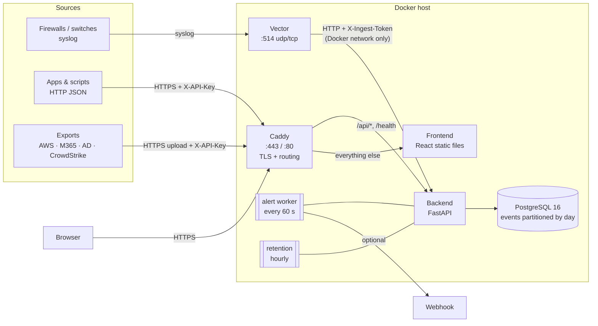

# Architecture

A small multi-tenant log management (SIEM-lite) system. It ingests logs from seven kinds of
sources, normalizes them into one schema, stores them in PostgreSQL, and offers search, a
dashboard and brute-force alerts. Everything runs from one `docker-compose.yml`, either on a
single VM (**appliance**) or on a public cloud VM with a real HTTPS domain (**SaaS**).

## Components



| Component | Job | Why this choice |
|-----------|-----|-----------------|
| **Caddy** | The only public entry point. Terminates TLS and routes `/api/*` and `/health` to the backend, everything else to the frontend. Blocks `/api/ingest/syslog` from outside. | Automatic HTTPS: Let's Encrypt in SaaS mode, its own local CA in appliance mode, from one Caddyfile. |
| **Vector** | Listens for syslog on 514 and forwards raw lines plus the sender IP to the backend in batches; retries if the backend is down. | Handles the network side (UDP/TCP, batching, retries) so the backend only gets HTTP. Parsing stays in Python, where it is unit-tested. |
| **Backend** | FastAPI app: ingest, normalizers, login, search, stats, alerts API. Two background tasks: the alert worker and retention. | Async Python, Pydantic validation, interactive API docs at `https://<host>/docs` for free. Background tasks run in-process: no extra queue or container for two periodic jobs. |
| **PostgreSQL 16** | Events, users, API keys, alerts. | One database for everything. Day partitioning, JSONB and GIN indexes cover search and retention at this scale. |
| **Frontend** | React + Vite + TypeScript SPA (dashboard, search, alerts), built to static files. | Served by a tiny internal Caddy; no Node at runtime. |

All images are multi-arch (linux/amd64 and linux/arm64).

## Data flow of one event

1. **Arrives**:
   - syslog: device → Vector → `POST /api/ingest/syslog` (internal token);
   - JSON: client → `POST /api/ingest?source=...` (API key);
   - file: client → `POST /api/ingest/file` (API key).
2. **Tenant is decided**: from the API key, or for syslog from the sender IP (`SYSLOG_TENANT_MAP`,
   otherwise `DEFAULT_TENANT`). A `tenant` field in the body is never trusted: if it names a
   different tenant than the key's, that event is rejected (so a mislabelled sample can't land in the
   wrong tenant).
3. **Normalized**: `backend/app/normalizers/<source>.py` maps the payload to the common schema
   (`Event`, a Pydantic model that rejects bad values). The original payload is kept in `raw`.
4. **Checked**: events outside `[now − RETENTION_DAYS, now + 1 day]` are rejected with a reason.
   Bad events never block the good ones in the same batch.
5. **Stored**: one transaction makes sure the day partitions exist, then
   COPY → temp table → `INSERT … ON CONFLICT DO NOTHING`.
   A trigger sets a `fingerprint` (sha256 of tenant + source + raw), so duplicates are skipped.
6. **Detected**: the alert worker picks up failed logins that arrived in the last 10 minutes and
   checks their event-time history for 5+ failures from one IP in any 5-minute window.
7. **Expired**: the retention job drops whole day partitions older than `RETENTION_DAYS`.

## Storage

```
events (PARTITION BY RANGE ts)            users       api_keys        alerts
 ├─ events_20261005                          role        key_hash        rule_id, src_ip
 ├─ events_20261006                          tenant      tenant          window_start/end
 ├─ …  one table per UTC day                 bcrypt      revoked_at      event_count, status
 └─ events_20261019  (created 7 days ahead)                              webhook_sent_at
```

- **Day partitions.** Retention is `DROP TABLE events_YYYYMMDD`: instant, with no slow
  `DELETE` and no VACUUM bloat. Queries filtered by time only read the relevant days.
  There is deliberately no DEFAULT partition, so an out-of-range event is rejected instead of
  being kept forever.
- **Indexes** (declared once on the parent, so every partition gets them):
  - `(tenant, ts DESC)` for every search;
  - `(tenant, src_ip, ts)` for the alert rule;
  - GIN on `raw` and `_tags` for JSON and tag filters;
  - `ingested_at` for the worker;
  - `UNIQUE (fingerprint, ts)` for duplicates.
- **Types**: `inet` for IPs (subnet search with `<<=`), `jsonb` for the original log, and `text[]` for tags.
- **Migrations**: numbered SQL files applied at startup by a short runner (`app/migrate.py`),
  each in a transaction, guarded by an advisory lock.

## Security

| Concern | How it's handled |
|---------|------------------|
| Tenant isolation | Every data endpoint gets its tenant from one dependency (`scoped_tenant`). It returns the JWT's tenant for viewers and returns 403 if a viewer asks for another; admins may pass `?tenant=`. The value goes into every SQL `WHERE`. Another tenant's event or alert by id returns 404, so its existence isn't revealed. Covered by `tests/test_tenant_isolation.py`. |
| Login | Passwords are hashed with bcrypt. Wrong password and unknown user give the same error and the same timing (a dummy hash check). JWT is HS256 with the algorithm pinned on decode, which blocks `alg: none`. The backend refuses to start with a short or example `JWT_SECRET`. |
| Ingest keys | Random `lm_…` keys, stored as SHA-256 (high-entropy keys don't need bcrypt, and a fixed hash allows an indexed lookup). Revocable. |
| Syslog | No authentication exists in the protocol. Port 514 can be limited with `SYSLOG_BIND` or a firewall. The internal endpoint needs a shared token, and Caddy returns 404 for it from outside. |
| SQL injection | All values are passed as query parameters; column names are fixed in code. Tested with hostile input. |
| Secrets | Only from environment variables (`.env`, git-ignored). Every variable is documented in `.env.example`. |
| Transport | HTTPS everywhere through Caddy. Postgres, the backend and the frontend are not published to the host. |

## Alerting

Rule `brute_force_login`: 5 or more `auth_failure` events from one `src_ip`, in one tenant,
within 5 minutes. It uses SQL window functions (`count(*) OVER (… RANGE '5 min' PRECEDING)`).

- **Event time, not clock time.** Logs that arrive late, or come in an uploaded file, are still caught.
- **De-duplication.** Overlapping windows are merged into one burst. A burst within 5 minutes
  of an existing alert for the same tenant and IP extends that alert instead of creating a new one.
- **One evaluator.** An advisory lock means only one backend process evaluates at a time.
- **Webhook.** It is sent after the transaction commits, and failed deliveries are retried for an hour.

## Trade-offs and what I'd change at scale

| Today | Why it's fine here | At scale |
|-------|--------------------|----------|
| PostgreSQL for events | Simple, one database, real transactions, enough for millions of rows per day | **ClickHouse** for events (MergeTree, `ORDER BY (tenant, ts)`, TTL for retention), keeping Postgres for users, rules and alerts |
| Workers inside the API process | No extra moving parts; advisory locks make several processes safe | A separate worker service or scheduler, and more rules defined as data |
| Free-text search with `ILIKE` over a few columns and `raw::text` | Bounded by tenant and time range | Full-text index (`tsvector`) or a search engine |
| JWT in `localStorage` | Simple; survives reloads | httpOnly cookie plus CSRF protection; refresh tokens |
| Content fingerprint for duplicates | Re-uploads and Vector retries are safe | Prefer vendor event IDs where they exist |
| Syslog tenant by sender IP | Matches how appliances are deployed | Per-tenant collectors or TLS syslog with client certificates |
